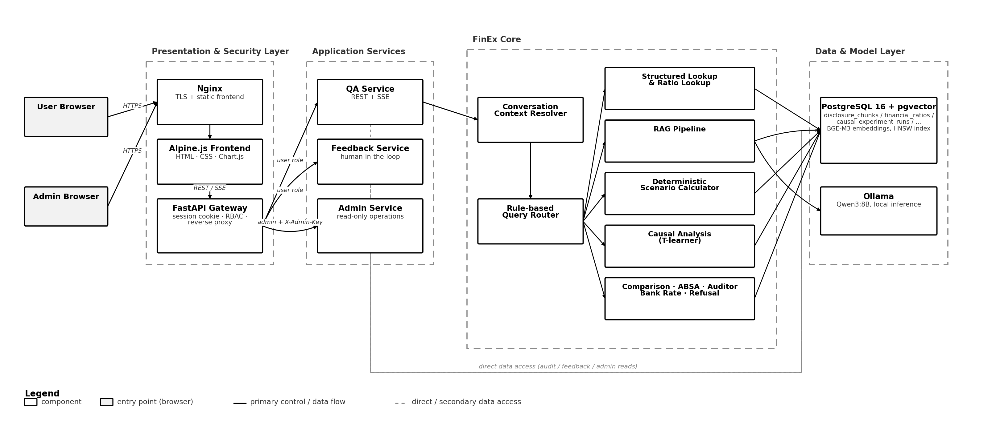
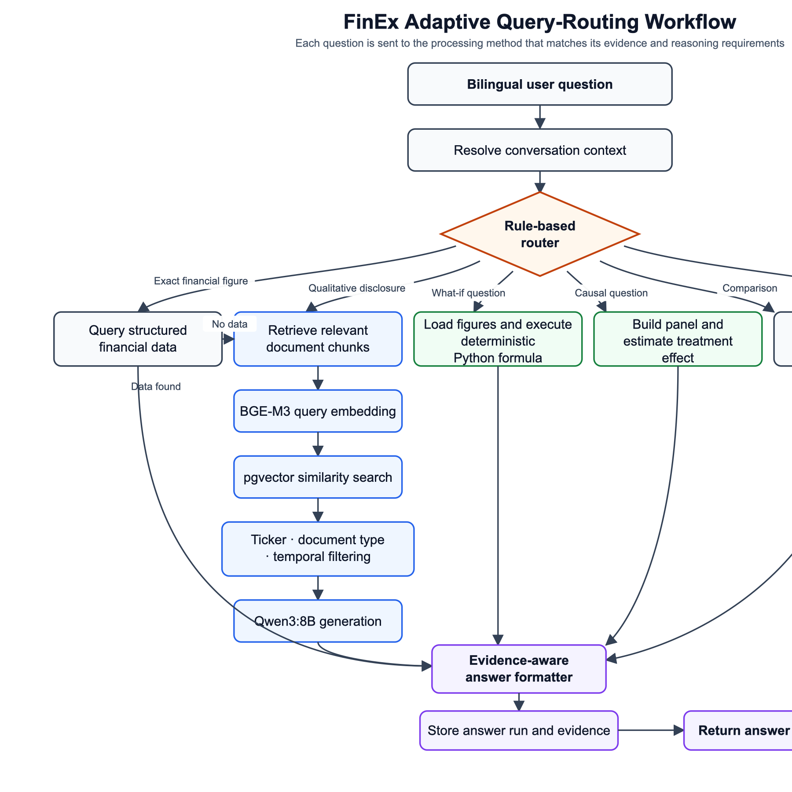
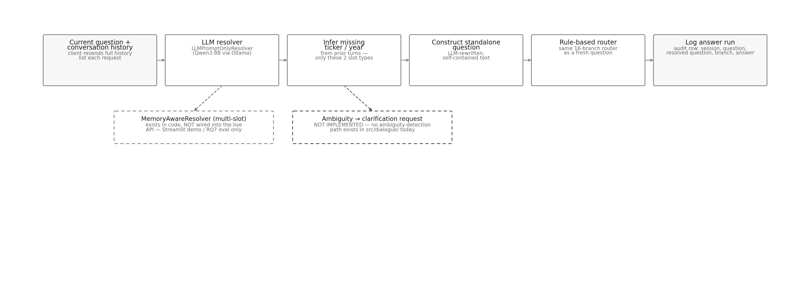

# Running FinEx

Two ways to run this: **Docker** (recommended — one command, everything
containerized) or **native `dev.sh`** (faster iteration if you're actively
editing code, no Docker rebuild step). Pick one; don't run both against the
same database port at the same time.



## 0. Prerequisites

- Docker Desktop (for the Docker path), **or** Python 3.11+ and a local
  PostgreSQL 16 + pgvector (for the native path)
- [Ollama](https://ollama.com) if you want the RAG/what-if-narrative/ABSA
  branches to work locally (structured branches — line-item lookup, ratio
  lookup, price snapshot, auditor lookup — do **not** need an LLM at all)
- `git clone` this repo, then `cp .env.example .env` and fill in real values
  (DB credentials at minimum)

Data is **not** included in this repo (see root README's "Project layout").
Populate `data/` via `scripts/batch_ingest_vietstock.py` and the Airflow
DAGs under `infra/airflow/` — check each script's own docstring for exact
usage before running it against a fresh database.

---

## Path A — Docker (recommended)

```bash
cp .env.example .env
bash api/certs/generate_dev_certs.sh     # self-signed dev TLS cert, one-time
docker compose up -d
```

That starts Postgres, Airflow, Ollama (in-container), and the 4 API
services behind an nginx frontend. First boot pulls the Ollama model
(~5GB) — give it a few minutes.

**Using a native Ollama install instead of the containerized one** (much
faster on Apple Silicon — Docker Desktop on macOS can't reach the GPU, so
the containerized Ollama runs CPU-only and is noticeably slower):

```bash
# in .env:
OLLAMA_HOST_DOCKER=http://host.docker.internal:11434
# then:
ollama serve                              # in its own terminal, left running
docker compose up -d --scale ollama=0     # every other service starts normally
```

Open **https://localhost:8443** (self-signed cert — your browser will warn
once, that's expected for a dev cert).

**Running a one-off script (e.g. the router smoke test) against the Docker
stack:** the API containers don't publish their ports to the host — only
nginx (8443/8480) does. Run scripts *inside* the `qa` container instead,
where `127.0.0.1:8101` is reachable (`./scripts` is bind-mounted read-only
into it):

```bash
docker compose exec qa python scripts/test_router_batch.py
```

## Path B — native (`dev.sh`)

```bash
python3 -m venv .venv && source .venv/bin/activate
pip install -r requirements.txt

cd api
python3 -m venv .venv && source .venv/bin/activate
pip install -r requirements.txt
cp .env.example .env        # fill in real values
bash dev.sh                 # starts all 4 API services + gateway in one terminal
```

Open **https://localhost:8443**. Service docs (Swagger UI) at
`http://127.0.0.1:8101/docs` (qa), `8102` (feedback), `8103` (admin).

Running a script directly on the host works as-is here, since the ports are
actually bound to `127.0.0.1`:

```bash
python scripts/test_router_batch.py
```

---

## Verifying it's actually working



1. `curl -s http://127.0.0.1:8101/health` (native) or
   `docker compose exec qa curl -s http://127.0.0.1:8101/health` (Docker) —
   should return `"status": "ok"`. `"degraded"` means Ollama isn't reachable;
   structured branches (line-item/ratio/price/auditor lookup) still work,
   RAG/ABSA/causal-narrative branches won't.
2. Run the batch test script (see above) — it exercises all three systems
   (S1/S2/S3) across every router branch plus a conversational-memory
   (RQ3) test, and prints a pass/fail summary instead of you clicking
   through the UI one question at a time.

## Troubleshooting

**`curl: (7) Failed to connect` on port 8101/8102/8103 in Docker mode** —
these ports are intentionally not published to the host (only nginx is; see
`docker-compose.yml`'s comments). Either curl from inside a container
(`docker compose exec qa curl ...`) or go through the gateway/frontend on
8443 instead.

**Ollama requests time out or the container gets killed (exit 137)** —
Docker Desktop's memory limit is usually too small to hold the LLM (qwen3:8b
needs ~5-6GB) alongside Postgres/Airflow/the 4 API services. Either raise
Docker Desktop's memory limit, or switch to a native Ollama install (see
Path A above) — the host has your machine's full RAM, no Docker cap.

**`/health` says `"ok"` but a RAG/ABSA question hangs for a long time** —
that's expected on first use: the embedding model (~2.2GB) downloads and
loads lazily on the first RAG call. Subsequent calls are fast.



**A follow-up question ("What about its total liabilities?") isn't being
understood** — this needs actual conversation history sent with the
request (the `history` field on `/ask`), and it needs Ollama reachable (the
rewrite step is itself an LLM call). If Ollama is down, the question is
silently sent as-is — no error, just no memory. Check `/health` first.
